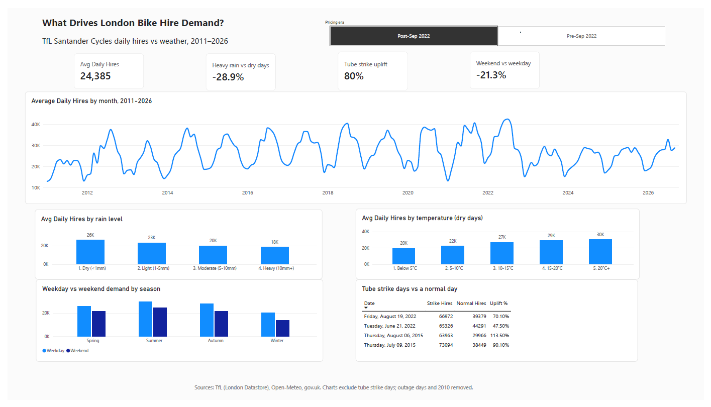
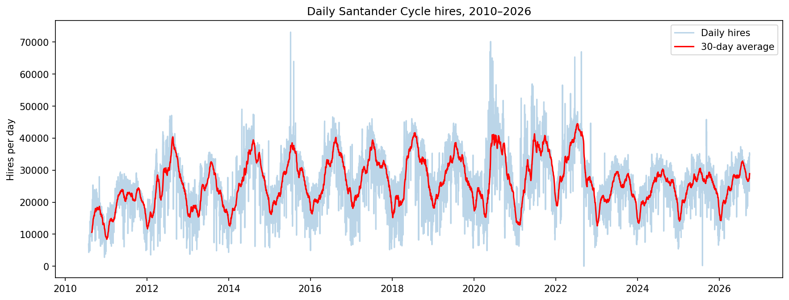

# What Drives London Bike Hire Demand?

Analysis of 15+ years of TfL Santander Cycles daily hire data (2011–2026) combined with historical weather data, to understand how weather, season and day type affect demand, and how TfL could use this to plan bike redistribution.



## Business question
How much do weather, seasonality and weekday/weekend patterns and transport disruption change bike hire demand, and what should TfL do about it?

## Key findings
*Weather and day-type findings use the current pricing era (Sep 2022 – Sep 2026), excluding tube strike days.*

- **Tube strikes are the biggest single driver of demand.** Compared with the same weekday in the same month, strike days saw **+48% to +114%** more hires (~80% on average). The 9 July 2015 strike was the busiest day in the scheme's history (73,094 hires). Strike-day hires cluster around 64–73k regardless of baseline, which suggests a possible fleet capacity ceiling.
- **Rain cuts demand in proportion to how heavy it is:** light rain −11%, moderate −23%, heavy rain **−29%** vs dry days. Even in heavy rain ~70% of demand remains, which points to a large committed commuter base.
- **Temperature matters up to a point:** dry days above 20°C see **55% more hires** than days below 5°C, but the effect flattens above 15°C. The biggest jump happens around 10°C.
- **It's mainly a commuter scheme:** weekdays are busier than weekends in every season. The weekend drop is smallest in summer (−17%) and largest in winter (−33%), so leisure riders are far more weather-sensitive than commuters.
- **The scheme has gone through four phases:** rapid growth (2011–14), maturity (2015–19), a COVID-era boom peaking in 2022 (31.7k hires/day), and a **26% drop in 2023**, the first full year after the Sep 2022 tariff change. Demand has since recovered steadily (+2.5% in 2024, +4% in 2025), consistent with TfL/Santander's reported ~3% growth in 2025.



## Recommendations
1. **Pre-position bikes before announced tube strikes.** Strikes are known days in advance and nearly double demand, which makes them the clearest opportunity to capture extra hires.
2. **Use weather forecasts for redistribution planning.** Mild, dry days (10°C+) need the most bikes and staff.
3. **Schedule maintenance in cold, wet periods**, when demand is ~30% lower.
4. **Target leisure marketing at spring and autumn weekends**, when leisure demand is present but softening.

## Approach
1. **Data collection (Python):** merged TfL daily hires, Open-Meteo weather and gov.uk bank holidays → `01_data_collection.ipynb`
2. **Exploration & cleaning (Python):** identified outages, tube strikes and a structural break in Sep 2022 → `02_exploration_cleaning.ipynb`
3. **Analysis (SQL / PostgreSQL):** CTEs, window functions (`LAG`, `FIRST_VALUE`), `FILTER` pivots and correlated subqueries → `sql/`
4. **Dashboard (Power BI):** connected directly to PostgreSQL; DAX measures and calculated columns → `london_bike_dashboard.pbix` / `.pdf`

## Data cleaning decisions
- **Removed:** system outage days (10–11 Sep 2022 planned upgrade for the e-bike launch; 5 Aug 2025 software failure) and 2010 (launch year, partial).
- **Flagged, not removed:** COVID period (23 Mar 2020 – 19 Jul 2021) and tube strike days. These reflect real but unusual behaviour.
- **Pricing era split:** the Sep 2022 tariff change created a step change in hire counts, so driver analysis uses the post-change era only.

## Limitations
- From Aug 2017, TfL notes recent daily figures may be revised slightly for ~2 weeks.
- The gov.uk bank holiday feed only covers recent years.
- Temperature and daylight move together, so their effects can't be fully separated.
- Weather is measured at a single central London point.
- Only four tube strike days were analysed; more strike dates would strengthen the finding.

## Data sources
- TfL daily cycle hires: London Datastore ("Number of Bicycle Hires")
- Daily London weather: Open-Meteo historical API
- UK bank holidays: gov.uk

## Tools
Python (pandas, matplotlib, requests) · SQL (PostgreSQL) · Power BI (DAX) · Git/GitHub

## How to run
1. Install the libraries:
```
   pip install -r requirements.txt
```
2. Download the TfL "Number of Bicycle Hires" file from the London Datastore into `data/`
3. Run `01_data_collection.ipynb`, then `02_exploration_cleaning.ipynb`
4. In PostgreSQL, create a database called `london_bikes`, run `sql/01_create_table.sql`, and import `data/bikes_analysis_ready.csv`
5. Run the queries in `sql/02_analysis.sql`
6. Open `london_bike_dashboard.pbix` in Power BI Desktop (or view `london_bike_dashboard.pdf`)